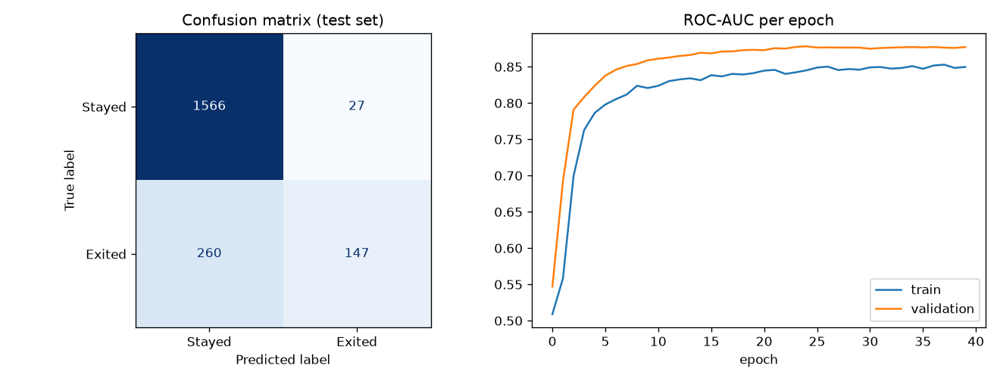

# 🏦 Bank Customer Churn Prediction (ANN)


Banks lose revenue every time a customer closes their account, and keeping a customer costs far less than winning a new one.
This project trains an **artificial neural network** on 10,000 bank customers to predict who is likely to leave. It also ships an **interactive Streamlit app** that scores any customer profile in real time.

## 📊 Results

Evaluated on a held-out, stratified test set of 2,000 customers:

| Metric | Score |
|---|---|
| Accuracy | **85.7%** (baseline that always predicts "stays": 79.7%) |
| ROC-AUC | **0.856** |
| Precision on churners | 0.84 |
| Recall on churners | 0.36 |



The model is very precise when it flags a customer: 84% of the flagged customers really do leave.
It catches about a third of all churners at the default 0.5 threshold. Lowering the threshold or adding class weights trades some precision for more recall, depending on how expensive a missed churner is for the business.

## 🧠 How it works

```text
Churn_Modelling.csv ──► preprocessing ──────────────────────────► ANN ──► churn probability
                         • one-hot: Geography, Gender             16 ReLU → Dropout(0.2)
                         • standard scaling: 8 numeric features    → 8 ReLU → 1 sigmoid
```

- **Features:** country, gender, age, tenure, credit score, balance, number of products, credit card, active membership, estimated salary
- **Training:** Adam optimiser, binary cross-entropy, early stopping on validation AUC, fixed random seed for reproducibility
- **Leakage-safe:** the preprocessor is fitted on the training split only and saved together with the model, so the app applies exactly the same transformation

## 🚀 Quick start

```bash
git clone https://github.com/salemyousry4-design/Back-churn-prediction-in-ANN.git
cd Back-churn-prediction-in-ANN
pip install -r requirements.txt

streamlit run app.py      # open the prediction app (a trained model is included)
python train.py           # optional: retrain and regenerate the report
```

## 📁 Project structure

```text
├── app.py                      # Streamlit prediction app
├── train.py                    # training + evaluation pipeline
├── data/Churn_Modelling.csv    # 10,000 customers, 14 columns
├── models/                     # trained model + fitted preprocessor
├── reports/                    # metrics.json and evaluation plots
└── notebooks/                  # original exploratory notebook
```

## 🔭 Next steps

- Tune the decision threshold for higher recall on churners
- Compare against gradient boosting (XGBoost / LightGBM)
- Explain individual predictions with SHAP

## 👤 Author

**Salem Yousry**: [GitHub](https://github.com/salemyousry4-design)
